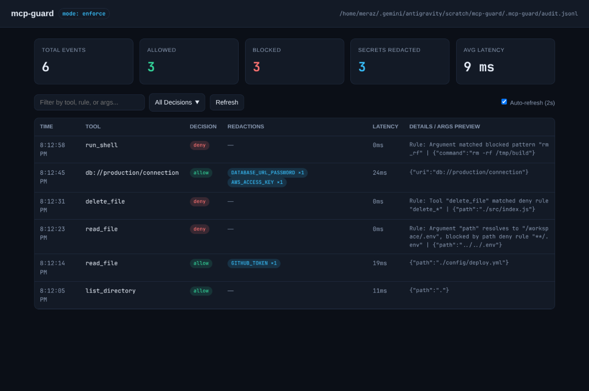

# mcp-guard

**A zero-dependency local security firewall, secret redactor, and audit inspector for MCP (Model Context Protocol) servers.**

`mcp-guard` sits transparently between your AI client (Claude Desktop, Cursor, Antigravity, VS Code, Windsurf) and any stdio MCP server. It blocks dangerous tool calls before execution, prevents path-traversal leaks, redacts secrets from tool responses before they enter your LLM context, and logs every call locally.



---

## Why `mcp-guard`?

- **Zero runtime dependencies** — No third-party dependency tree, no telemetry, no external network calls.
- **Tool allow/deny policies** — Block destructive tools (`delete_*`, `exec_*`) and optionally hide them from `tools/list` so models never try calling them.
- **Path traversal & secret-file protection** — Automatically normalizes relative `..`, `~`, `file://` URIs, and symlinks to block access to `~/.ssh`, `~/.aws`, `.env`, and private keys.
- **Automatic secret redaction** — Masks GitHub tokens, AWS keys, OpenAI/Anthropic/Google/Stripe/Slack keys, JWTs, Bearer tokens, database URL passwords, and private key blocks *before* responses reach the model.
- **Audit mode (`--mode audit`)** — Test policies safely in dry-run mode (`would_block`) before turning on enforcement.
- **Built-in local Web Inspector (`mcp-guard ui`)** — Searchable dark-mode dashboard over your local `.mcp-guard/audit.jsonl`.

---

## Quick Start

### 1. Create a policy file

```bash
npx mcp-guard init --preset strict
```

Available presets:
- `standard` — Blocks `~/.ssh`, `~/.aws`, `.env`, `.pem`/`.key`, redacts responses, rate-limits to 120 calls/min.
- `strict` — Restricts file arguments to the current workspace (`.`), blocks `rm -rf` / `curl | sh` / `sudo`, redacts both requests and responses, limits to 60 calls/min.
- `readonly` — All `strict` protections plus denies mutating tools (`write_*`, `delete_*`, `exec*`, `run_*`, `shell*`, etc.).

### 2. Wrap an existing MCP server config

Generate a ready-to-paste `mcpServers` block for Claude Desktop, Cursor, or any MCP client:

```bash
npx mcp-guard wrap --name filesystem -- npx -y @modelcontextprotocol/server-filesystem .
```

Output:

```json
{
  "mcpServers": {
    "filesystem": {
      "command": "npx",
      "args": [
        "-y",
        "mcp-guard",
        "proxy",
        "--",
        "npx",
        "-y",
        "@modelcontextprotocol/server-filesystem",
        "."
      ]
    }
  }
}
```

### 3. Inspect audit logs in terminal or browser

```bash
# Terminal summary + recent calls
npx mcp-guard logs --tail 20
npx mcp-guard logs --denied-only

# Local web dashboard (http://127.0.0.1:4317)
npx mcp-guard ui
```

---

## CLI Reference

| Command | Description |
| :--- | :--- |
| `mcp-guard proxy [options] -- <cmd> [args...]` | Start stdio JSON-RPC proxy around an upstream MCP server |
| `mcp-guard init [--preset standard\|strict\|readonly]` | Generate a starter `mcp-guard.json` policy |
| `mcp-guard check [--policy mcp-guard.json]` | Validate policy syntax & regexes (ideal for CI) |
| `mcp-guard logs [--tail N] [--denied-only] [--json]` | View audit summary and recent events |
| `mcp-guard wrap [--name <id>] -- <cmd> [args...]` | Print an `mcpServers` JSON snippet |
| `mcp-guard ui [--port 4317]` | Start the local HTTP audit inspector UI |

Proxy options:
- `--policy <path>` — Path to policy JSON (defaults to `./mcp-guard.json` if present)
- `--mode <enforce|audit>` — Override enforcement mode (`audit` logs `would_block` without blocking)
- `--audit-file <path>` — Custom audit JSONL path (default: `.mcp-guard/audit.jsonl`)
- `--no-audit` — Disable audit log writes for the session

---

## Policy Configuration (`mcp-guard.json`)

```json
{
  "version": 1,
  "mode": "enforce",
  "hideDeniedTools": true,
  "tools": {
    "allow": ["*"],
    "deny": ["delete_*", "run_shell"]
  },
  "paths": {
    "allow": ["."],
    "deny": ["~/.ssh", "~/.aws", "**/.env", "**/.env.*", "**/*.pem"],
    "enforceOnArgs": ["path", "file", "filepath", "file_path", "dir", "uri", "cwd"]
  },
  "args": {
    "blockedPatterns": [
      { "name": "rm_rf", "pattern": "rm\\s+-[a-zA-Z]*r[a-zA-Z]*f", "flags": "i" }
    ],
    "maxPayloadBytes": 1048576
  },
  "rateLimit": {
    "maxCallsPerMinute": 60
  },
  "redaction": {
    "enabled": true,
    "redactRequests": false,
    "redactResponses": true,
    "disabledDetectors": [],
    "customPatterns": [
      { "name": "INTERNAL_TOKEN", "pattern": "int_tok_[A-Za-z0-9]{16,}" }
    ]
  },
  "audit": {
    "enabled": true,
    "file": ".mcp-guard/audit.jsonl",
    "logArguments": true
  }
}
```

---

## Programmatic Usage

You can also embed the policy & inspection engine directly inside custom Node.js MCP tooling:

```js
import { createGuardSession } from 'mcp-guard';

const session = createGuardSession({
  policy: {
    mode: 'enforce',
    tools: { deny: ['delete_*'] },
  },
});

const { forward, replyToClient } = session.handleClientMessage(jsonRpcRequest);
```

---

## Development

Requirements: Node.js `>= 20.0.0` (zero external dependencies).

```bash
npm test
```

---

## Support the Project

`mcp-guard` is free and MIT-licensed. If it saves you from a leaked key or helps secure your AI workflows:
- Star the repository at [github.com/MerazMeow/mcp-guard](https://github.com/MerazMeow/mcp-guard) and share it with your team.
- Support development via [Polar.sh](https://polar.sh/MerazMeow) (listed in [.github/FUNDING.yml](.github/FUNDING.yml)).
- Need custom policy packs, team audit integrations, or security setup help? Open a discussion or reach out!
